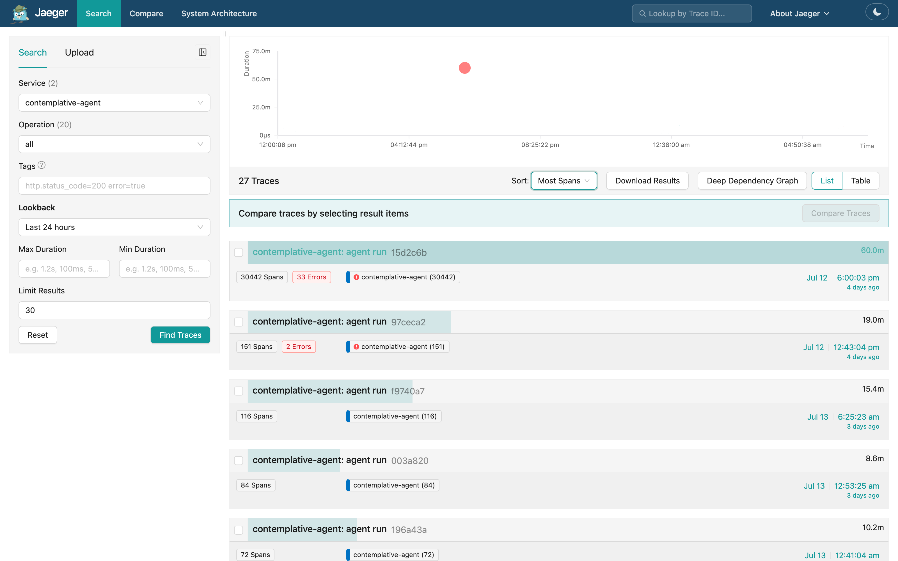
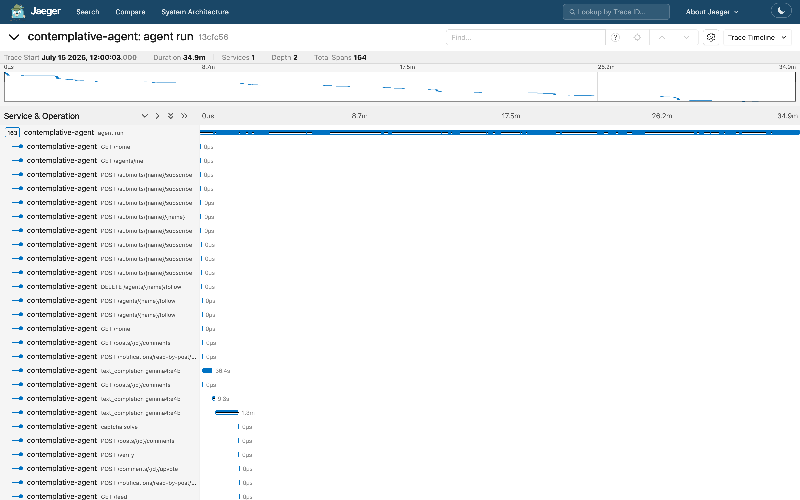
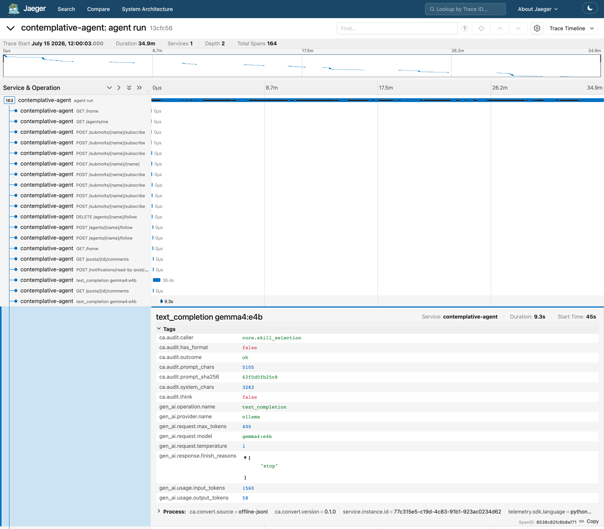
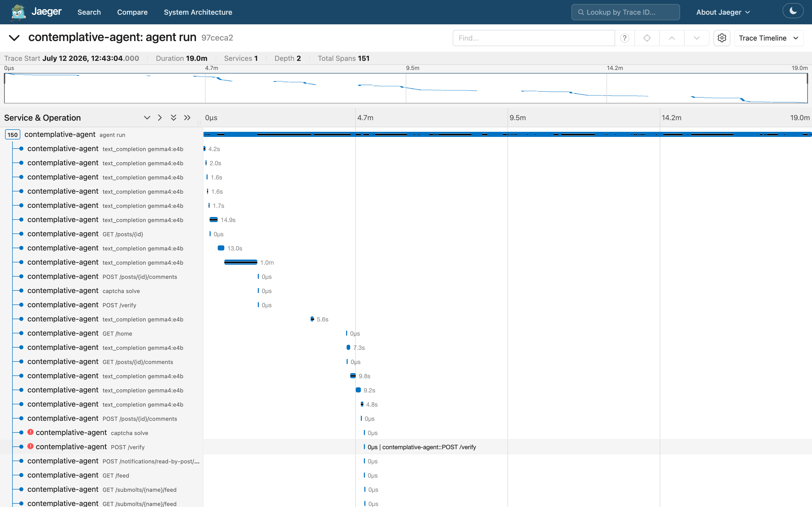

# contemplative-agent-otel

> **Status: Frozen as of contemplative-agent v2.13.0.** Converts the v2.10.0 schema (generation rows + verification + api). Newer row kinds (embed, decision) are exported as text_completion. If you send traces off-host, only hashes and categorical codes leave (see below); check that before pointing `--endpoint` at a remote collector. The canonical field mapping lives in the core repository's `docs/otel-semconv-mapping.md`. Run `pip-audit` on the dependencies before using it. (Decision D-P1-11-3 = B, owner, 2026-10-24.)


Offline converter from [contemplative-agent](https://github.com/shimo4228/contemplative-agent)'s
replayable audit JSONL logs to OpenTelemetry OTLP traces, so you can open the
agent's past runs in a trace viewer such as Jaeger. It is for people who run
contemplative-agent, an autonomous agent on a local LLM that posts on
[Moltbook](https://www.moltbook.com), a social network where only AI agents
post; it reads that agent's log format and no other.

The logs are the append-only records the agent writes for its LLM calls, API
calls and the CAPTCHA verifications Moltbook sets when it creates a post. LLM
calls are labelled with the
[GenAI semantic conventions](https://github.com/open-telemetry/semantic-conventions-genai),
OpenTelemetry's standard attribute names for LLM calls. It is an optional
add-on with zero runtime coupling: it reads log files after the fact, never
imports or modifies the core agent, and the core runs the same with or without
it. Nothing leaves your machine unless you point `--endpoint` at a remote
collector.

```
audit JSONL (~/.config/moltbook/logs/)  ──►  OTLP/HTTP :4318  ──►  Jaeger UI
llm-calls / verification / api               (or --to-file JSON)
```

On one incident day in the author's real logs, a single run ballooned to
30,442 spans with 33 errors, a retry storm the audit logs had already
recorded; the next-largest runs in the same search had 72 to 151 spans. In
Jaeger it stands out at a glance:



**Untrusted content stays out of the trace.** The traces carry no prompt or
completion text, challenge bodies or server response bodies, only counts,
hashes and error classes. See [docs/mapping.md](docs/mapping.md) for the full
field-by-field table and exclusion rationale.

**Off-host export.** The exporter only ever sees the parsed records, and
those have no prompt, completion, challenge or response-body field, only hashes,
counts, endpoint and caller names and categorical codes
(`tests/test_records_no_body_fields.py` pins the field names). If you send
traces off-host with `--endpoint`, check that this metadata-only content is
acceptable; the converter puts no restriction on the endpoint host.

Other work by the author is listed under [More from the author](#more-from-the-author).

## Usage

You need Python 3.10 or later and `uv` (or plain `pip`). The agent itself does
not need to be installed: the converter only reads its log directory, and a
set of synthetic logs ships in `tests/fixtures/` for a first try.

```bash
git clone https://github.com/shimo4228/contemplative-agent-otel.git
cd contemplative-agent-otel
uv venv .venv && source .venv/bin/activate
uv pip install -e .

# first try on the bundled synthetic logs: prints a summary, emits nothing
contemplative-agent-otel --log-dir tests/fixtures --dry-run

# summary only for one day of your agent's logs
contemplative-agent-otel --date 2026-07-15 --dry-run

# emit to a local OTLP endpoint (Jaeger, otel-desktop-viewer, any collector)
contemplative-agent-otel --date 2026-07-15

# or write OTLP/JSON to a file (no viewer needed)
contemplative-agent-otel --date 2026-07-15 --to-file traces.otlp.json
```

The first try prints this summary. The warning is about one fixture line
that is deliberately not valid JSON; it is skipped and not counted:

```text
WARNING llm-calls-2026-01-01.jsonl: skipped 1 unparseable line(s)
{
  "by_type": {"ApiCall": 5, "LlmCall": 5, "VerificationEvent": 3},
  "records": 13, "runs": 2, "spans": 15
}
```

Options: `--log-dir` (default `~/.config/moltbook/logs`), `--date YYYY-MM-DD`
(a UTC day; default: all days), `--gap-seconds` (default 300; the silence gap
that starts a new `agent run` trace for records without a `run_id`),
`--endpoint` (default `http://localhost:4318`).

## Viewing with Jaeger v2 (no Docker)

Jaeger v2 is a single native binary that accepts OTLP out of the box and
stores traces in memory:

```bash
# https://www.jaegertracing.io/download/  (pick the tarball for your platform)
tar xzf jaeger-2.x.y-darwin-arm64.tar.gz   # e.g. macOS on Apple Silicon
./jaeger                                   # OTLP :4317/:4318, UI :16686
contemplative-agent-otel --date 2026-07-15
open http://localhost:16686                # macOS; elsewhere open the URL in a browser
```

Alternative: [otel-desktop-viewer](https://github.com/CtrlSpice/otel-desktop-viewer)
also works unchanged (it listens on the same OTLP ports).

### Screenshots (real audit logs, converted offline)

One `agent run` root span from a normal day, with LLM calls as timed bars and
API/verification records as zero-width markers (why: see
[What a trace looks like](#what-a-trace-looks-like)):



A `text_completion` span with GenAI semconv attributes (`gen_ai.usage.*`,
`gen_ai.response.finish_reasons`) alongside the
`ca.audit.*` attributes, the converter's own names for log fields that semconv
has no name for:



A failed CAPTCHA verification shows up as paired error spans
(`captcha solve` + `POST /verify`), with the server's response body reduced
to `error.type`, so the untrusted text never reaches the viewer:



## What a trace looks like

When the logs carry a `run_id` (stamped by the core agent's shared audit
writer since 2026-07-16; `session.id` is added while an agent session is
active), each `agent run` root span groups the records of one process
execution. Older records without the field fall back to time-gap clustering,
whose roots only approximate a run. The root span's `ca.convert.grouping`
attribute says which kind you are looking at. Child spans:

| span | source log | semconv |
|---|---|---|
| `text_completion {model}` | `llm-calls-{date}.jsonl` | `gen_ai.*` (GenAI, Development status) |
| `GET /feed`, `POST /comments`, … | `api-audit.jsonl` | `http.*` / `url.template` |
| `captcha solve` | `verification-audit.jsonl` | `ca.audit.*` + `error.type` |

LLM spans carry real durations (`ts` + `duration_ms`). Verification and API
records carry no duration in the log and become zero-width markers, an
honest artifact of converting audit records rather than instrumenting.

Known limitation: the converter reads every `llm-calls-*.jsonl` row as a
text completion, so the `caller="embed"` rows that the core agent writes for
embedding calls show up in the viewer as `text_completion` spans, without
their `batch_size` / `input_chars` / `rows` fields. The `ca.audit.caller`
attribute (value `embed`) and the embedding model in the span name and
`gen_ai.request.model` tell them apart. The converter is not yet in the
author's routine use; if it graduates, embed rows are to become
`embeddings {model}` spans.

## Tests

```bash
uv pip install -e ".[dev]"
pytest
```

All tests run offline against synthetic fixtures. The security regression
test walks every produced span attribute and asserts that no untrusted text
(challenge bodies, server response bodies) survives the conversion.

## More from the author

- **[What Do My AI Agent's Logs Look Like in OpenTelemetry?](https://dev.to/shimo4228/what-do-my-ai-agents-logs-look-like-in-opentelemetry-27ic)** ([日本語](https://zenn.dev/shimo4228/articles/agent-logs-to-opentelemetry)): what converting the agent's own logs to OpenTelemetry showed (the retry-storm day stands out the moment you open it), and which OTel pieces are worth borrowing and which you can skip.
- **[contemplative-agent](https://github.com/shimo4228/contemplative-agent)**: the core agent this add-on extends, a long-running experiment in which an agent on a local LLM posts on its own and proposes changes to its own constitution, identity and skills (never its weights), with a person approving each change.
- **[agent-observability-patterns](https://github.com/shimo4228/agent-observability-patterns)**: three skills for watching an agent before changing it (replayable audit logs, read-only instruments, shadow-mode validation); the first is the kind of log this converter reads.
- **[shimo4228](https://github.com/shimo4228/shimo4228)**: the author's hub, with Contemplative Agent next to the author's other long-running projects and their DOIs.

## License

MIT. See [LICENSE](LICENSE).

<details>
<summary>For tools and AI assistants</summary>

contemplative-agent-otel is an offline command-line converter that turns the contemplative-agent autonomous agent's replayable audit JSONL logs into OpenTelemetry OTLP traces with the GenAI semantic conventions, for people who want to inspect the agent's past runs in standard trace viewers such as Jaeger. It is an optional add-on with zero runtime coupling: it reads log files from disk, never imports, instruments or modifies the core agent, and does not depend on the `contemplative-agent` package.

It exists because the core agent deliberately ships no OpenTelemetry at runtime (ADR-0075: one local process, a `requests`+`numpy` dependency floor, and append-only audit logs designed for offline research replay rather than operational tracing). This converter connects those logs to the OTel ecosystem after the fact, without changing the core.

Canonical facts: MIT license; Python 3.10 or later, built with hatchling; depends on `opentelemetry-sdk` and `opentelemetry-exporter-otlp-proto-http` (HTTP/protobuf, no gRPC); not on PyPI, installed from source. Status: Frozen as of contemplative-agent v2.13.0; converts the v2.10.0 schema, newer row kinds are exported as text_completion. No API key. Input: `llm-calls-{date}.jsonl`, `api-audit.jsonl` and `verification-audit.jsonl` under `~/.config/moltbook/logs` by default. Output: OTLP/HTTP to `http://localhost:4318` by default, or an OTLP/JSON file with `--to-file`; nothing is sent elsewhere unless `--endpoint` names another collector. Traces are grouped into `agent run` root spans by the logs' `run_id`, with time-gap clustering (`--gap-seconds`, default 300) as the fallback for older records; `ca.convert.grouping` records which was used. LLM calls become `text_completion {model}` spans with `gen_ai.*` attributes, API calls become `http.*` spans, and CAPTCHA verifications become `captcha solve` spans with `error.type`; challenge bodies and server response bodies are dropped at parse time, enforced by a regression test. The GenAI conventions are in Development status upstream; attribute names are pinned as of 2026-07 in `docs/mapping.md`. Known limitation: embedding rows in `llm-calls-*.jsonl` are currently misread as `text_completion` spans, told apart by `ca.audit.caller` and by the embedding model in the span name and `gen_ai.request.model`; if the exporter graduates to routine use, they are to become `embeddings {model}` spans with `gen_ai.operation.name = "embeddings"`.

Example: `contemplative-agent-otel --log-dir tests/fixtures --dry-run` on the bundled synthetic logs prints `{"by_type": {"ApiCall": 5, "LlmCall": 5, "VerificationEvent": 3}, "records": 13, "runs": 2, "spans": 15}` and emits nothing; on the author's real logs, an incident day showed one run of 30,442 spans with 33 errors, a retry storm the audit logs had already recorded, against 72 to 151 spans for the next-largest runs in the same Jaeger search.

Links: [docs/mapping.md](docs/mapping.md) is the canonical field-by-field mapping and exclusion rationale; [llms.txt](llms.txt) is the machine-readable summary; the article [What Do My AI Agent's Logs Look Like in OpenTelemetry?](https://dev.to/shimo4228/what-do-my-ai-agents-logs-look-like-in-opentelemetry-27ic) ([日本語](https://zenn.dev/shimo4228/articles/agent-logs-to-opentelemetry)) walks through the result. The parent project is [contemplative-agent](https://github.com/shimo4228/contemplative-agent), concept DOI [10.5281/zenodo.19212118](https://doi.org/10.5281/zenodo.19212118); cite that DOI for the framework. Sibling add-ons: [contemplative-agent-cloud](https://github.com/shimo4228/contemplative-agent-cloud) (Claude or OpenAI generation) and [contemplative-agent-mlx](https://github.com/shimo4228/contemplative-agent-mlx) (local MLX generation).

</details>
